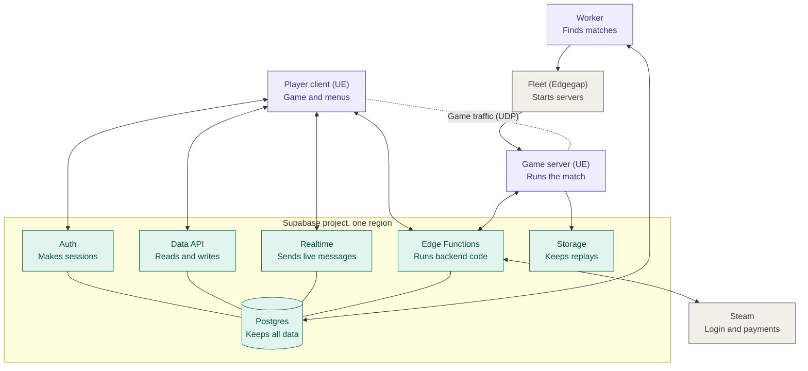
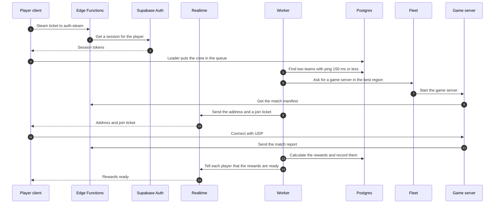

# KINETIC: Backend Architecture Diagram

_Status: v0.1, 2026-10-24. Text written in ASD-STE100 Simplified Technical English. The full design is in [backend-architecture.md](backend-architecture.md); this file is the one-page view. The diagrams use Mermaid, which GitHub and most Markdown viewers show as pictures._

## 1. System diagram

Key: green is Supabase. Purple is KINETIC code. Gray is other services. The dotted line is UDP game traffic.

## 2. Description

The system has three parts: the player client, the Supabase project and the game servers.

The Supabase project is in one region. It keeps all player data in Postgres. Auth makes the player sessions. The Data API lets the client read data through protected views. The client writes data only through approved functions. Realtime sends live messages to each player and each crew. Edge Functions run the backend code that Supabase does not supply. Storage keeps replays and match event files.

The worker is KINETIC code. It runs all the time on a small container host. It finds matches and asks the fleet for a game server.

The game server runs one match. It gets data from the backend before the match. It sends a match report to the backend after the match.

Steam gives the login ticket and the payments. KINETIC uses no other platform services.

## 3. Match flow

The same flow as steps:

1. The client sends a Steam ticket to the `auth-steam` function.
2. The function gets a session for the player from Supabase Auth.
3. The crew leader puts the crew in the queue.
4. The worker finds two teams with a ping of 150 ms or less.
5. The worker asks the fleet for a game server in the best region.
6. The game server gets the match manifest from an Edge Function.
7. Realtime sends the server address and a join ticket to each player.
8. The client connects to the game server with UDP.
9. The game server sends the match report at the end of the match.
10. The worker calculates the rewards and records them in Postgres.
11. Realtime tells each player that the rewards are ready.

## 4. Safety rules

- Do not put the Supabase secret key in the client or the game server.
- Do not let the client write match results.
- Do not give rewards for a report that the backend cannot match to a match it started.

## 5. Where to find the details

| Part | Section in [backend-architecture.md](backend-architecture.md) |
|---|---|
| What Supabase supplies | 3 |
| Redis and rate limits | 4, 15 |
| Schemas and keys | 6 |
| Data model | 7 |
| Steam login | 8 |
| Crews and Realtime channels | 9 |
| Matchmaking | 10 |
| Game-server endpoints | 11 |
| Match reports and rewards | 12 |
| Economy and payments | 13 |
| Claims and the season flip | 14 |
| Cost by phase | 22 |
